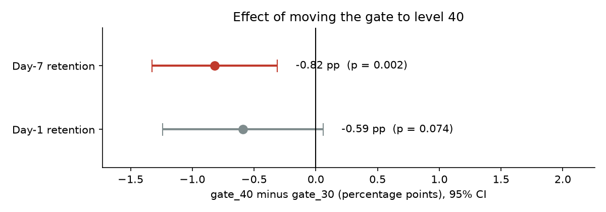
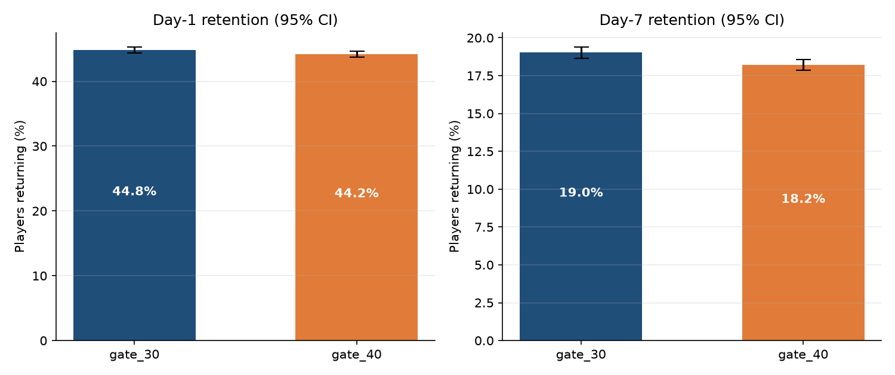
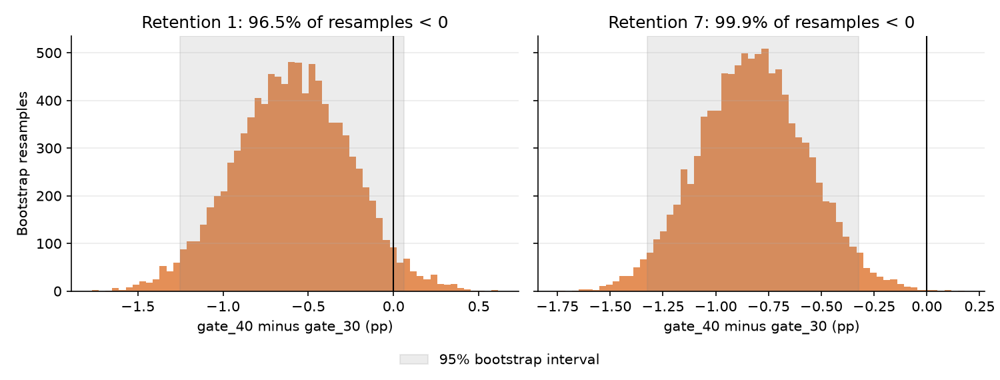
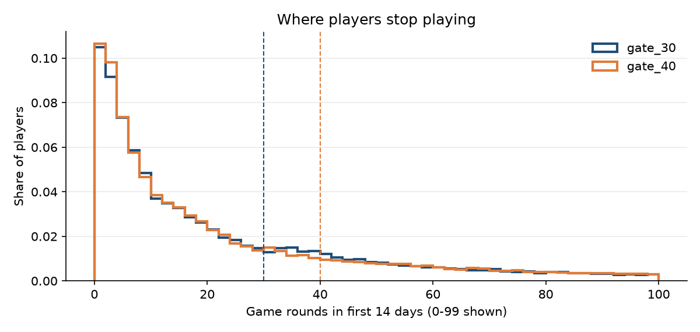
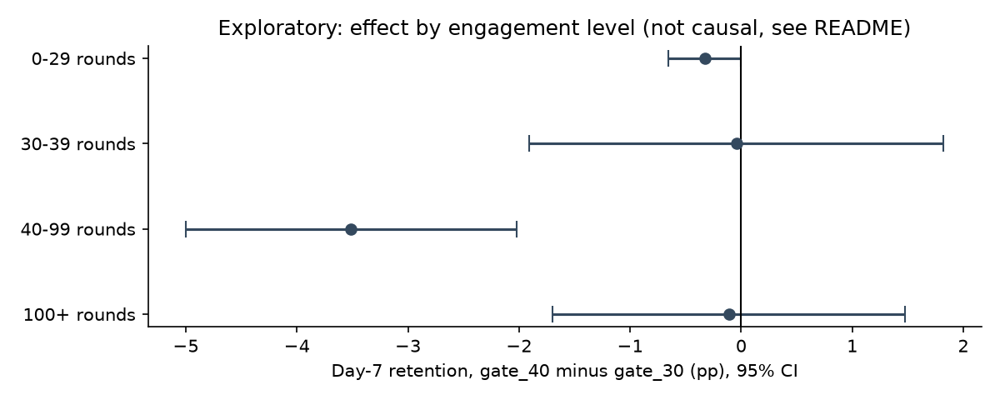

# Cookie Cats A/B Test: should the first gate move from level 30 to level 40?


Statistical analysis of a real A/B test on 90,189 players of a mobile game, ending in a ship / don't-ship recommendation.
Sanity checks (including a sample-ratio-mismatch stress test), two-proportion z-test, bootstrap, power analysis, Bayesian probability and segment analysis with multiple-testing correction, all written out with NumPy/SciPy in one script.

## Business question
Cookie Cats is a mobile puzzle game. At certain levels players hit a **gate**: they must wait or pay to continue.
The product team tested moving the first gate from **level 30 (control)** to **level 40 (treatment)**, and new players were randomly assigned to one of the two versions.

**Decision to make:** ship `gate_40` or keep `gate_30`?

- **Primary metric:** day-7 retention (share of players who come back 7 days after install), the metric closest to long-term revenue.
- **Secondary:** day-1 retention, game rounds played in the first 14 days.
- **Decision rule (set before looking at results):** ship `gate_40` only if the 95% confidence interval for the change in day-7 retention is above zero; keep `gate_30` if it is below zero.

## Result

**Keep the gate at level 30.** Moving it to level 40 lowered day-7 retention from **19.02% to 18.20% (-0.82 percentage points, -4.3% relative, p = 0.002)**. That is about **820 fewer players still active after a week for every 100,000 installs**. Day-1 retention and game rounds point the same way but are not significant on their own. No metric shows any upside for `gate_40`.

| Metric | gate_30 | gate_40 | Difference | 95% CI | p-value |
|---|---|---|---|---|---|
| Day-1 retention | 44.82% | 44.23% | -0.59 pp | [-1.24, +0.06] | 0.074 |
| **Day-7 retention** | **19.02%** | **18.20%** | **-0.82 pp** | **[-1.33, -0.31]** | **0.002** |
| Game rounds (median) | 17 | 16 | -1 | [-1, 0] | 0.050 (Mann-Whitney) |



## Analysis steps

### 1. Sanity checks before trusting the test
- 90,189 players, no duplicate ids, no missing values.
- **Sample-ratio mismatch (SRM):** the split was meant to be 50/50 but came out 44,700 vs 45,489 (49.56% control). A chi-square goodness-of-fit test gives **χ² = 6.90, p = 0.009**, so the imbalance is unlikely to be chance. In a real company this means checking the assignment and logging pipeline before acting. See the stress test in step 2.
- Heavy-tailed engagement: 3,994 players (4.4%) never played a round, the 99th percentile is 493 rounds and one `gate_30` player logged 49,854 rounds. Game rounds are therefore compared with medians and a rank test, not means.

### 2. Retention: frequentist test
Two-proportion z-test: the p-value uses the pooled standard error (under H0 both groups share one rate) and the confidence interval uses the unpooled one. The formulas are written out in `ab_test.py` and cross-checked against SciPy's chi-square test of independence (same p-value).



**SRM stress test.** Gate_40 has 789 more players than expected. In the worst case for the conclusion, all 789 would be non-returning players who should not be there. Removing them makes gate_40 look as good as possible: the day-7 gap shrinks to **-0.50 pp (95% CI [-1.01, +0.01], p = 0.056)**. Even then gate_40 is not better, so the SRM can weaken the size of the loss but cannot flip the decision.

### 3. Bootstrap
10,000 bootstrap resamples per group give the same intervals as the normal approximation: day-7 [-1.33, -0.32] pp, with **99.9% of resamples below zero**. Day-1 [-1.25, +0.06] pp, with 96.5% below zero.



### 4. Power and minimum detectable effect
- **Day-7:** with ~45,000 players per group, the test detects a change of **0.73 pp** (3.8% relative) with 80% power at α = 0.05. The observed -0.82 pp is above that, so the test had **89% power**. This is not a lucky result on an underpowered test.
- **Day-1:** the minimum detectable effect is 0.93 pp, larger than the observed -0.59 pp, so power was only 43%. Detecting a drop of that size would need about **111,000 players per group**. The non-significant day-1 result means "too small to see with this sample", not "no effect".

### 5. Bayesian view
With a flat Beta(1, 1) prior on each retention rate:
- P(gate_30 has higher day-7 retention) = **99.9%**; 95% credible interval for the difference [-1.33, -0.31] pp.
- Expected day-7 retention lost by shipping gate_40: **0.82 pp**; by keeping gate_30: ~0.
- Day-1: P(gate_30 better) = 96.3%.

### 6. Engagement
Median rounds 17 vs 16 (means 52.5 vs 51.3), Mann-Whitney U p = 0.050: borderline, same direction as retention.
The distribution shows a small bump of `gate_30` players whose first 14 days end between 30 and 40 rounds, right after their gate. `gate_40` players get past that range but lose more players later.



### 7. Segments (exploratory)
Day-7 retention by engagement bucket, with Holm correction for 4 tests:

| Rounds played | Players | gate_30 | gate_40 | Difference | Holm p |
|---|---|---|---|---|---|
| 0-29 | 56,920 | 4.26% | 3.93% | -0.33 pp | 0.147 |
| 30-39 | 5,876 | 15.73% | 15.69% | -0.04 pp | 1.000 |
| **40-99** | 14,877 | 32.90% | 29.39% | **-3.51 pp** | **< 0.001** |
| 100+ | 12,516 | 71.14% | 71.03% | -0.11 pp | 1.000 |

The whole loss sits in players who played 40-99 rounds, the players who reach the gate in the gate_40 version during their first days.
**Caveat:** game rounds are measured *after* assignment and the gate itself changes how much people play, so these buckets are not randomized groups. They point to where to look next, not to a proven cause.



## Recommendation
1. **Do not ship gate_40.** Keep the first gate at level 30. Day-7 retention drops by 0.82 pp (-4.3%) with a well-powered, significant test. Every other metric points the same way, and nothing suggests an upside.
2. **Investigate the sample-ratio mismatch** with the engineering team (assignment and event logging). It does not change this decision (stress test above), but it must be fixed before the next experiment on the same pipeline.
3. **Next test idea:** the loss is concentrated in mid-engagement players (40-99 rounds). A follow-up could test a softer gate rather than a later one. To detect an effect as small as 0.5 pp in day-7 retention, plan for about **96,000 players per group**.

**Limitations:** sample-ratio mismatch of unknown origin. Retention is measured only up to day 7. No revenue or in-app purchase data, so the gate's direct monetization effect is not measured. One game and one test period.

## How to run
```powershell
python -m venv .venv
.venv\Scripts\Activate.ps1
pip install -r requirements.txt
# put cookie_cats.csv in data/ (see data/README.md)
python ab_test.py
```
Runs in a few seconds. Outputs: `results/summary.json` (every number in this README) and `figures/*.png`.

## Project structure
```
ab_test.py          checks, SRM stress test, z-test, bootstrap, power, Bayesian, segments, charts
data/README.md      where to download the dataset (CSV not committed)
results/            summary.json
figures/            charts used above
```

## Data
Kaggle: [Mobile Games A/B Testing - Cookie Cats](https://www.kaggle.com/datasets/mursideyarkin/mobile-games-ab-testing-cookie-cats) (originally from a DataCamp project, data from Tactile Entertainment).
